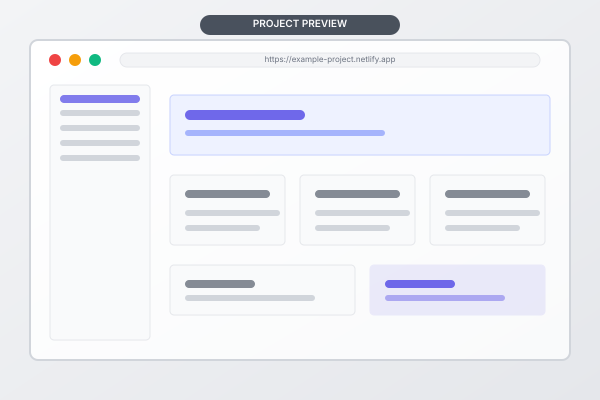

# Alex Johnson's Portfolio

A clean, modern, and responsive portfolio website built for a beginner developer/coder. This project showcases my skills, projects, and provides an easy way to get in touch.

[](https://yourusername.github.io/portfolio/)
[](LICENSE)

## 📸 Preview



## 🌟 Features

- **Fully Responsive** - Works seamlessly on mobile (320px+), tablet (768px+), and desktop (1024px+) screens
- **Clean & Modern Design** - Minimal aesthetic with smooth animations and good contrast
- **Mobile-First** - Built with mobile-first approach for optimal performance
- **Semantic HTML** - Proper HTML5 semantics for better accessibility and SEO
- **Smooth Navigation** - Sticky navbar with smooth scroll and active section highlighting
- **Interactive Elements** - Hover effects, fade-in animations on scroll, and back-to-top button
- **Contact Form** - Ready-to-integrate contact form (configured for [Formspree](https://formspree.io/))
- **Fast & Lightweight** - No frameworks or build tools, just pure HTML, CSS, and JavaScript

## 🛠️ Tech Stack

- **HTML5** - Semantic markup
- **CSS3** - Modern styling with CSS Custom Properties, Flexbox & Grid
- **JavaScript (ES6+)** - Vanilla JS for interactivity
- **Font Awesome 6** - Icons
- **Google Fonts (Inter)** - Typography

## 🚀 Getting Started

### Prerequisites

- A modern web browser (Chrome, Firefox, Edge, Safari)
- A code editor (VS Code recommended)

### Local Setup

1. **Clone the repository**

   ```bash
   git clone https://github.com/yourusername/portfolio.git
   ```

2. **Navigate to the project folder**

   ```bash
   cd portfolio
   ```

3. **Open the website**

   Simply open `index.html` in your browser by double-clicking it, or use a local server:

   ```bash
   # Using VS Code Live Server extension
   # Or using Python
   python -m http.server 8000
   ```

4. **View in browser**

   If using a local server, go to `http://localhost:8000`

## 🎨 Customization

This portfolio is designed to be easily customizable. Here's what you need to edit:

| File | What to Edit | Notes |
|---|---|---|
| `index.html` | Personal info (name, bio, email, social links, projects) | Look for bracketed values and placeholder text |
| `css/styles.css` | Color scheme, fonts, spacing | Edit CSS variables in `:root` section |
| `js/main.js` | Interactivity tweaks | Comments explain each section |
| `assets/images/` | Replace placeholders with your own photos | Use `profile-placeholder.svg` for your avatar, project images for your work |

### Quick Customization Tips

1. **Colors**: Change `--primary-color` in `:root` to your preferred brand color
2. **Name & Title**: Update in `index.html` title tag, navbar, hero, footer
3. **Contact Form**: Get a free Formspree ID and replace `your-form-id` in the form action
4. **Projects**: Replace the 3 placeholder projects with your actual work, including live demo and GitHub links
5. **Social Links**: Update GitHub, LinkedIn, and email URLs

## 📦 Deployment

This project can be deployed for free using any static hosting service. Here are some beginner-friendly options:

### GitHub Pages (Recommended)

1. Push your code to a GitHub repository named `portfolio`
2. Go to `Settings > Pages` in your repo
3. Select `Deploy from a branch` > `main` > `/ (root)`
4. Your site will be live at `https://yourusername.github.io/portfolio/`

### Netlify

1. Go to [netlify.com](https://www.netlify.com/) and drag-and-drop your project folder
2. Or connect your GitHub repo for automatic deployments
3. Get a custom domain if desired (free option available)

### Vercel

1. Go to [vercel.com](https://vercel.com/)
2. Import your GitHub repository
3. Deploy with one click - no configuration needed

## 🔮 Future Improvements

- [ ] Add dark mode toggle
- [ ] Implement blog section
- [ ] Add project filtering by tech stack
- [ ] Include testimonials section
- [ ] Add scroll reveal animations with better performance
- [ ] Integrate with GitHub API to auto-fetch projects

## 📄 License

This project is licensed under the MIT License - see the [LICENSE](LICENSE) file for details.

## 🤝 Contributing

This is a personal portfolio project, but feel free to fork it and customize it for your own use! If you find any bugs or have suggestions, feel free to open an issue.

## 📧 Contact

- **Email**: alex.johnson.dev@example.com
- **GitHub**: [@yourusername](https://github.com/yourusername)
- **LinkedIn**: [@yourusername](https://linkedin.com/in/yourusername)

---

Made with ❤️ by Alex Johnson. Thank you for visiting!